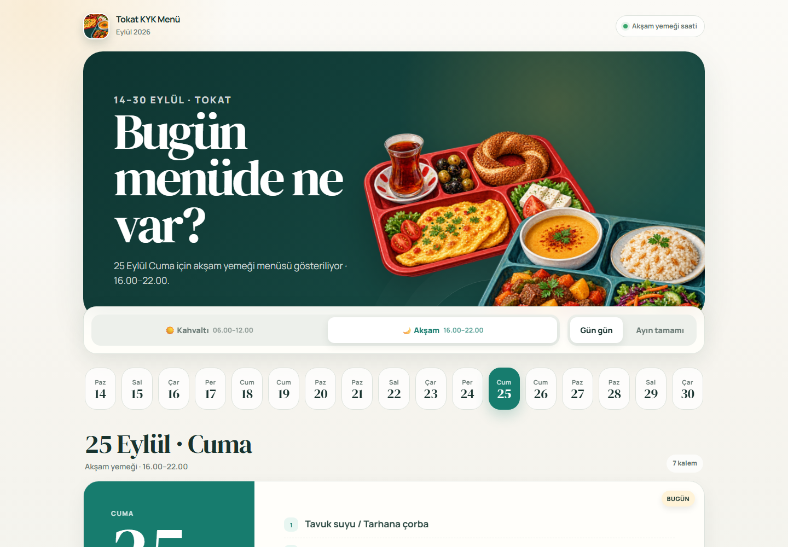

# Tokat KYK Yemek Menüsü

**Güncel uygulama:** [Tokat KYK Menü](https://cantsdlnn.github.io/tokat-kyk-menu/)

Alan adı geçişi bekleniyor; `tokatkykmenubc.com` henüz eski yayına bağlı.

Tokat Gençlik ve Spor İl Müdürlüğünün kahvaltı ve akşam yemeği menülerini gün gün veya aylık olarak gösteren responsive web uygulaması. Menüler `data/menus/YYYY-MM.json` dosyalarından üretilir.



## Özellikler

- Kahvaltı ve akşam yemeği ayrımı
- Günlük ve aylık menü görünümü
- Tokat saatine göre otomatik öğün seçimi
- Telefon, tablet ve masaüstü uyumlu tasarım
- Kurulum gerektirmeyen statik HTML/CSS/JavaScript yapısı

## Yerelde çalıştırma

Node.js 22 veya üzeriyle proje dizininde çalıştırın; bağımlılık kurulumu gerekmez:

```bash
npm run validate
npm test
npm run dev
```

Ardından `http://localhost:4173` adresini açın.

## Proje yapısı

- `src/index.html`: Arayüz ve etkileşimlerin kaynak kodu
- `data/menus/`: Aylık menü JSON dosyaları
- `dist/index.html`: `npm run build` ile üretilen yayın dosyası (doğrudan düzenlenmez)
- `dist/assets/`: Görsel ve yerel font dosyaları
- `dist/manifest.webmanifest`: Web uygulaması bilgileri
- `.github/workflows/pages.yml`: GitHub Pages doğrulama ve otomatik yayın
- `CLAUDE.md`: Claude Code proje kuralları
- `docs/CLAUDE-HANDOFF.md`: Kullanım ve devir rehberi
- `.openai/hosting.json`: Önceki Sites yayınının geri dönüş kaydı

## Menü güncelleme ve yayın

Yeni ayı `data/menus/YYYY-MM.json` dosyası olarak ekleyin. Tüm günler ve iki öğün bulunmalı; okunamayan satırlar kaynaktan doğrulanmalı. `npm run validate`, `npm test` ve `npm run build` çalıştırın. PR kontrolleri başarılı olduktan sonra main'e birleştirme GitHub Pages yayınını otomatik günceller.

Claude Code kullanımı için [devir rehberi](docs/CLAUDE-HANDOFF.md) ve [proje kuralları](CLAUDE.md).

Menü bilgileri, Tokat Gençlik ve Spor İl Müdürlüğünün yayımladığı görsellerden aktarılmıştır. Menü idare ve tedarik koşullarına göre değişebilir.

## Lisans

[MIT](LICENSE)
